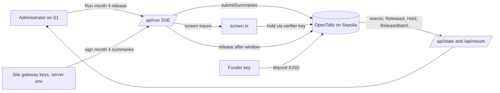

# Architecture — OpenTally
Mode: hackathon. Last structural change: 2026-10-19 (ADR-0001 to ADR-0004).

## Overview
OpenTally releases per-connection mini-grid grants by a stated rule on a public ledger. A funder deposits a test token into a programme contract on Sepolia; site gateways sign monthly consumption summaries; the contract verifies the signatures, applies the rule (days active, consumption threshold, sampling window), skips anything the verifier has held, and pays each eligible connection's grant to its site in one transaction. A Next.js app shows the tally, runs the month's release as a streamed pipeline, shows holds, and re-sums the totals from the chain's records.

## Components
| Component | Responsibility | Tech | Why it exists (requirement) | When it fails |
|---|---|---|---|---|
| `OpenTally` contract | escrow, site and connection registry, EIP-712 summary verification, rule, holds, release, events | Solidity 0.8.28, OpenZeppelin 5.6 (ERC20 interface, ECDSA, EIP712) | MUST: the release and the record are the product; the Technical & Blockchain line | a revert names the error; nothing moves |
| `OpenTallyFactory` | creates instances; `latest()` for the app; reset deploys a fresh one | Solidity | the demo reset without a database | the app reads the last known instance from env as fallback |
| `TestUSD` | 6-decimal test token for the escrow | Solidity (OZ ERC20) | a visible amount per grant without real money | n/a |
| Web app | S1 tally, S2 connection, S3 rule, S4 about, re-sum drawer | Next.js 16 App Router, Tailwind 4, Motion 14, @number-flow/react | the judged surface; UI-SPEC | partial state on chain outage |
| Run pipeline (`/api/run`) | signs month 4 summaries with the site gateway keys, submits, screens, holds, waits for the window, releases; streams five steps | Next.js route handler (Node runtime), viem 2 | J1; the demo's main result | a failed step reports the reason; Retry resumes from it |
| Screen (`lib/screen.ts`) | per-site robust z-scores on total kWh and variance; identical-trace and flat detection | TypeScript, no LLM | the hold path; the AI role as described (a screen that can only hold) | a screen error holds nothing and says so |
| Seed (`contracts/scripts/seed.ts`) | deterministic 3 sites, 50 connections, months 1 to 4 traces, 3 planted faults; registers, deposits, submits months 1 to 3 | TypeScript, viem | the demo world, reproducible; the reset path | re-run on a fresh instance |

## Data flow

## External services
| Service | Used for | Failure mode | Fallback | Limits / quota |
|---|---|---|---|---|
| Sepolia JSON-RPC (public, env) | reads and server-side writes | rate limit, outage | partial state with timestamp; the step fails with Retry | public endpoints rate-limit by IP; a second endpoint in env |
| Sepolia Etherscan | receipt and contract links, verified source | down | the hash with Copy | none needed for links |
| Google Fonts (next/font) | three faces | build-time fetch fails | system stacks | none |

## Key decisions
- ADR-0001 One programme contract plus a factory, not a database — the ledger is the record the judges score; a reset is a fresh instance.
- ADR-0002 EIP-712 summaries verified on-chain, signed server-side by demo gateway keys — the security moment (a wrong key reverts) is real, and no meter hardware exists in the window.
- ADR-0003 A statistical screen in TypeScript, no model provider — the card's "screen that can only hold" needs no LLM; one runtime; no paid route.
- ADR-0004 Hardhat 3 with viem and node:test; Next.js 16 on Vercel; viem in both — one client library across contracts, tests and app.

## Failure boundaries
A reverted release changes nothing on-chain; the UI keeps prior state and names the reason. A chain outage degrades reads to the last synced state (kept in memory per server instance and in the browser) with a timestamp. The explorer being down degrades links only. The run route holds a per-instance lock and refuses a second run within two minutes; a crashed run is resumable from its last confirmed step because each step is idempotent on-chain (summaries already submitted revert with `AlreadySubmitted` and are skipped; holds are idempotent; release pays only unpaid connections).

## Deployment
Contracts: `contracts/` with Hardhat 3; `npm run deploy:sepolia` deploys the token, the factory and a seeded instance; addresses written to `web/src/data/deployment.json` (committed) and verified on Sourcify. Web: `web/` on Vercel (root directory `web`), env: `RPC_URL`, `PROGRAMME_KEY`, `VERIFIER_KEY`, `GATEWAY_KEY_A/B/C`, `FUNDER_KEY` (reset only), `FACTORY_ADDRESS`. Rollback: redeploy the previous Vercel deployment; contracts are immutable, a bad instance is replaced through the factory. Local: `npx hardhat node` plus `npm run seed:local`, the app with `RPC_URL=http://127.0.0.1:8545`.

## Observability
Route handlers log each step with the instance address, the tx hash and the duration; the evidence ledger in `.prod-build/` holds every check run; Vercel runtime logs for 5xx.

## Known tradeoffs
Keys are server-held for the demo (stated); the window is 30 s on the demo instance (stated beside the terms' 14 days); the screen is statistical, not trained; totals are re-summed from events, which depends on the RPC returning full logs for the instance's block range.
