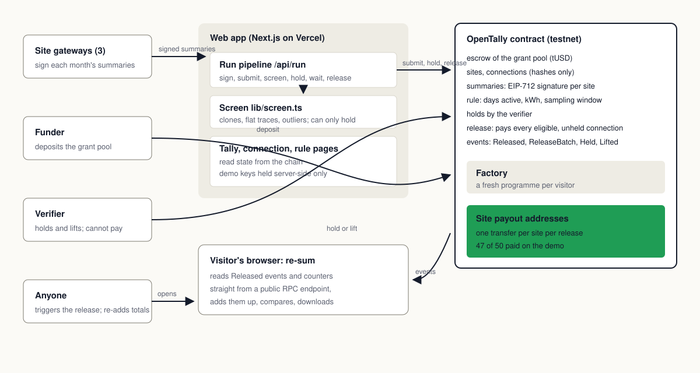
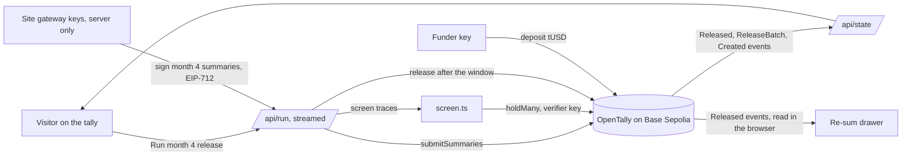

# Architecture

OpenTally releases per-connection mini-grid grants by one stated rule on a public ledger. A funder deposits a test token into a programme contract on Base Sepolia. Site gateways sign monthly consumption summaries; the contract verifies every signature, applies the rule (days active, a consumption threshold, a sampling window), skips anything the verifier holds, and pays each eligible connection's grant to its site in one transaction. A Next.js app shows the tally, runs the month's release as a streamed pipeline, lets the verifier lift or keep a hold, and re-sums the totals from the chain's records in the visitor's browser.

## Components

| Component | Responsibility | Tech | When it fails |
|---|---|---|---|
| `OpenTally` contract | escrow; site and connection registry; EIP-712 summary verification; the rule; holds and lifts; release; one `Released` record per paid connection | Solidity 0.8.28, OpenZeppelin 5.6 (SafeERC20, EIP712, ECDSA) | a revert names the error and nothing moves |
| `OpenTallyFactory` | creates a fresh programme instance per demo visitor; emits `Created` | Solidity | the app keeps showing the last released programme |
| `TestUSD` | 6-decimal test token for the escrow, no value | Solidity, OpenZeppelin ERC20 | n/a |
| Web app | the tally, the connection view, the rule and keys page, the about page, the re-sum drawer | Next.js 16 App Router, React 19, Tailwind 4, viem 2 | shows the last synced state with a timestamp |
| Run pipeline (`/api/run`) | signs month 4 summaries with the site gateway keys, submits them (one wrong-key summary is refused first), screens, holds, waits for the window, releases; streams five steps | Next.js route handler, Node runtime | a failed step names the reason; Retry resumes from it |
| Screen (`web/src/lib/screen.ts`) | per-site robust z-scores on consumption, plus exact checks for identical and flat traces | TypeScript statistics, no model | holds nothing and says so |
| Seeding (`contracts/scripts/lib/seedChain.ts`, `web/src/lib/reset.ts`) | deterministic 3 sites, 50 connections, months 1 to 4 traces with 3 planted faults; registers, deposits, submits months 1 to 3 | TypeScript, viem | a spare that fails to seed is never shown to a visitor |

## Data flow

## External services

| Service | Used for | Failure mode | Fallback |
|---|---|---|---|
| Base Sepolia JSON-RPC (public, load-balanced) | reads and server-side writes | a node a block behind; log range caps; outage | reads pinned to our latest write's block; chunked log reads; partial state with a timestamp; see the technical specification |
| Base Sepolia sequencer | signed transactions | nonce errors | retried with a fresh nonce |
| Blockscout and Basescan | receipt and contract links, verified source | down | the hash with Copy |
| Vercel | hosting the web app | function timeout | the page follows a run on the chain if its stream drops |

## Key decisions

- **One programme contract plus a factory, not a database.** The ledger is the record anyone can check; a fresh programme is a new instance.
- **EIP-712 summaries verified on-chain, signed server-side by demo gateway keys.** The security moment (a wrong key is refused) is real, and no meter hardware exists in the build window. A real programme gives each key to its holder.
- **A statistical screen, no model provider.** A screen that can only hold needs to be explainable more than it needs to be clever: every hold names its reason.
- **Release is permissionless after the window.** No office sits between the rule and the payment; the verifier stops a payment with a hold, not a recommendation.
- **Hardhat 3 with viem and node:test; Next.js 16 on Vercel; viem in both.** One client library across contracts, tests and app.

## Deployment

Contracts: `contracts/` with Hardhat 3; `npm run deploy:base-sepolia` deploys the token and the factory, creates and seeds spare programmes, and writes the addresses to `web/src/data/deployment.json`. Source is verified on Sourcify and Blockscout. Web: `web/` on Vercel, with `DEMO_MNEMONIC` (sensitive) and optionally `RPC_URL`, `NEXT_PUBLIC_RPC_URL`, `SEND_RPC_URL` and `LOG_SPAN`. Contracts are immutable; a bad programme is replaced through the factory.

## Known tradeoffs

Keys are server-held for the demo, and the page says so. The sampling window is 30 seconds on the demo instead of the terms' 14 days, also stated on screen. The screen is statistics, not a trained model. Summary storage grows with connections; the roadmap rolls each site's month into one Merkle root.
