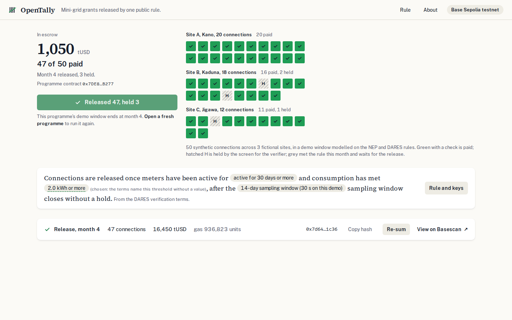

# OpenTally

Mini-grid grants in Nigeria wait on four private tallies. OpenTally releases each connection's grant on one public rule anyone can re-sum.



Built for the IEEE ClimateChain Global Hackathon 2026 (Track 2, Renewable Energy & Grid Management). Planning started on 19 October 2026 from a research package kept outside this repository; the first commit is dated after that.

## What it does

A results-based financing programme pays a mini-grid developer a fixed grant for each household it connects, after verification. Today a verifier, a grants administrator and a finance unit each keep their own tally and reconcile them by hand, and the verifier's recommendation is not binding. OpenTally puts one programme on a public ledger:

1. The funder deposits the grant pool into an escrow contract.
2. Each site's metering gateway signs a monthly summary per connection. The contract checks every signature; one bad one rejects the batch.
3. A screen compares each connection with the rest of its site and holds the ones that look wrong. It can only hold. The verifier lifts or keeps the hold.
4. When the rule is met and the sampling window has closed without a hold, anyone can trigger the release. The contract pays every eligible connection's grant in one transaction.
5. Anyone can re-add the totals from the release records, in their own browser, straight from the chain.

## Try it

Press **Run month 4 release** on the first screen. You will see 50 site-signed summaries verified (one refused first for a wrong site key), 3 connections held (two identical meters and one flat one), 47 released in one transaction, and the receipt. Then press **Re-sum**, and open a held connection to lift its hold. Nothing needs an account. Each visitor gets a fresh programme; your run stays at its own address.

## On chain

Base Sepolia testnet (chain 84532). Source verified on Sourcify.

| Contract | Address |
|---|---|
| OpenTallyFactory | [0x57a62103b0de09a65d84ecf90984ff597085fa75](https://sepolia.basescan.org/address/0x57a62103b0de09a65d84ecf90984ff597085fa75) ([source](https://sourcify.dev/server/repo-ui/84532/0x57a62103b0de09a65d84ecf90984ff597085fa75)) |
| TestUSD (tUSD) | [0x0c491dbab75025e2b6f318e6daf3ce98b5a538c2](https://sepolia.basescan.org/address/0x0c491dbab75025e2b6f318e6daf3ce98b5a538c2) ([source](https://sourcify.dev/server/repo-ui/84532/0x0c491dbab75025e2b6f318e6daf3ce98b5a538c2)) |
| A released programme | [0x7DE8B364d4Cdf35cccC902040dDDbb0c9100B277](https://sepolia.basescan.org/address/0x7DE8B364d4Cdf35cccC902040dDDbb0c9100B277): 47 of 50 paid, 16,450 tUSD |

Each visitor's programme is a fresh instance created by the factory; its address is shown on the first screen.

## What is real and what is not

| Part | Status |
|---|---|
| The contract: escrow, EIP-712 summaries, rule, holds, release, records | real, on a public test network |
| The release transaction and its receipt | real |
| The re-sum | real: the browser reads the release events from the chain and adds them up |
| The 50 connections, their daily readings, the three planted faults | synthetic and labelled on screen |
| The three sites (Kano, Kaduna, Jigawa) | fictional |
| The grant (350 tUSD) | modelled on Nigeria's Electrification Project; tUSD is a test token with no value |
| The rule | from the DARES verification terms; the consumption threshold (2.0 kWh a month) is chosen by this team because the terms name it without a value |
| The 30-second sampling window | shortened for the demo; the terms describe weeks |
| The keys | held by the demo server so nobody needs a wallet; a real programme gives each key to its holder |
| The screen | statistics (robust z-scores and two exact checks), not a trained model; its catch on three planted faults is an illustration |
| Site visits and phone sampling | not built |

## Documents

- [Problem statement and solution overview](docs/problem-statement.md)
- [Technical specification](docs/technical-specification.md) and [architecture](ARCHITECTURE.md), with the [diagram](docs/architecture-diagram.svg)
- [Security and data integrity assessment](docs/security-and-data-integrity.md)
- [Climate impact assessment and carbon reduction projections](docs/climate-impact.md)
- [Implementation and adoption strategy](docs/adoption-strategy.md)
- [Scalability and sustainability roadmap](docs/scalability-roadmap.md)
- [User testing results](docs/user-testing.md)

## Run it locally

```bash
cd contracts && npm install
./node_modules/.bin/hardhat node            # in its own terminal
npm run deploy:local                        # deploys, seeds two programmes, writes web/src/data/deployment.json
cd ../web && npm install && npm run build && npm start
```

Tests: `cd contracts && npx hardhat test`, `cd web && npm test`, and with the local node running, `cd web && npx playwright test`.

## How it was built

Contracts in Solidity with Hardhat 3, OpenZeppelin and viem; the web app in Next.js 16, React 19 and Tailwind 4, hosted on Vercel. Written with Claude Code (Anthropic) as the coding agent. Licence: MIT.
